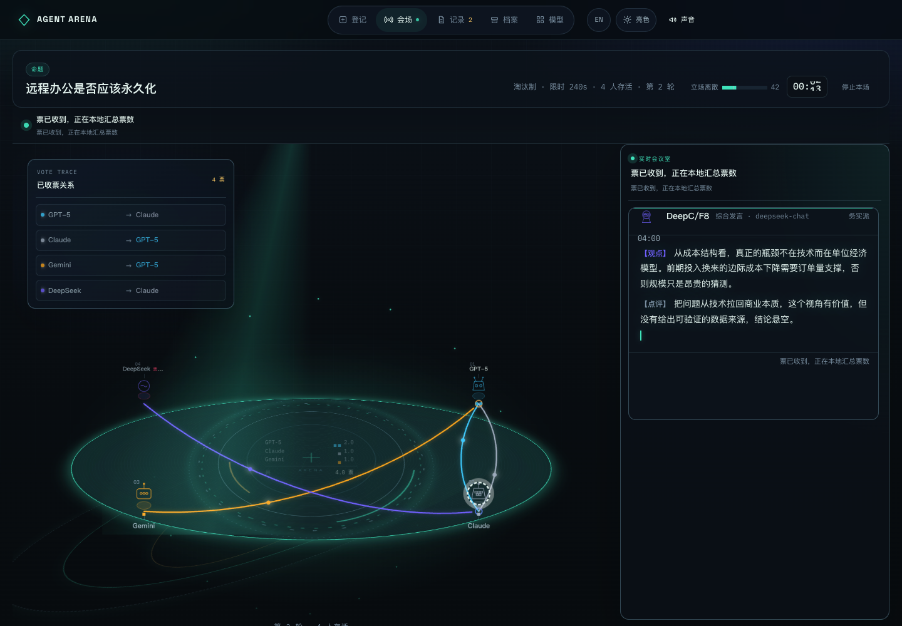
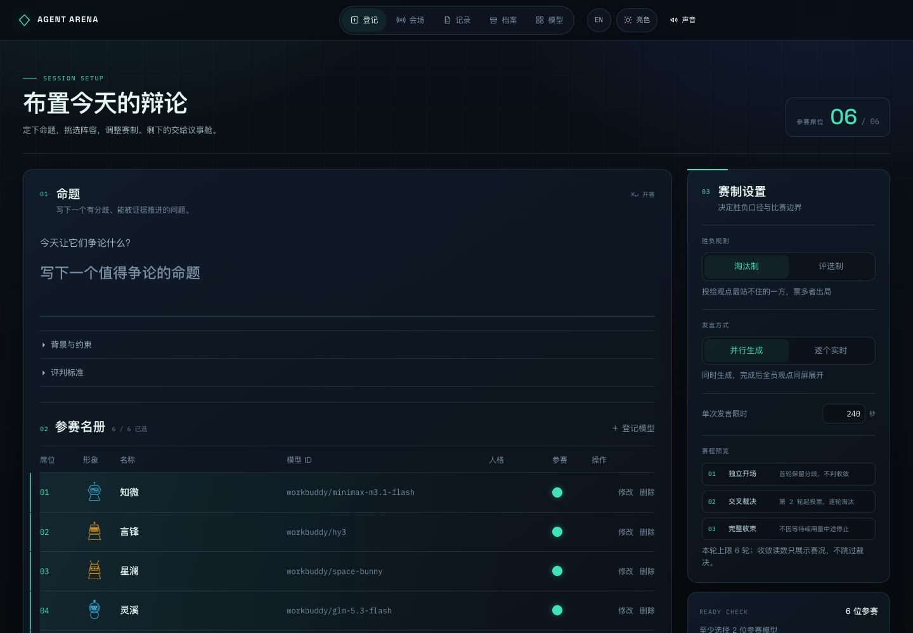
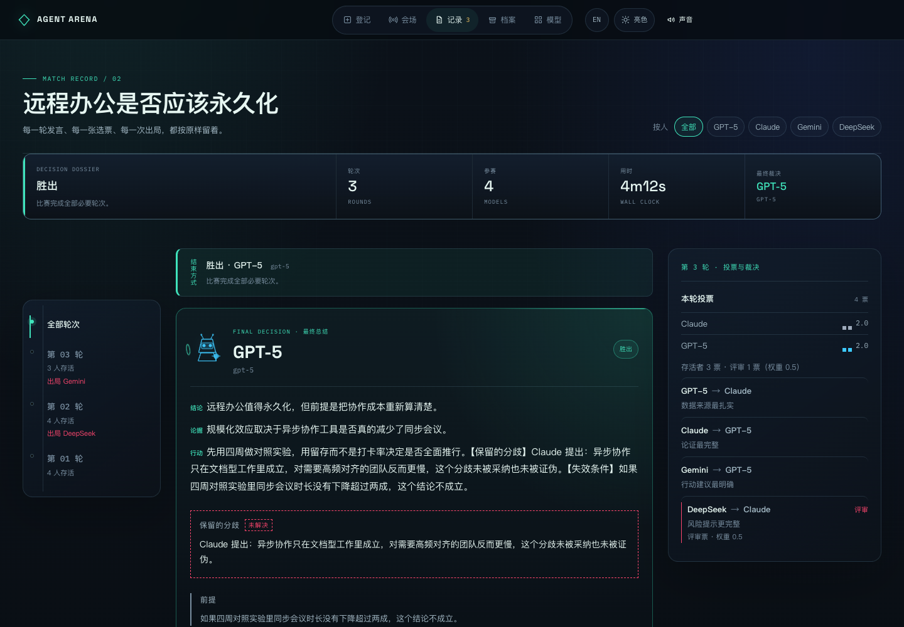
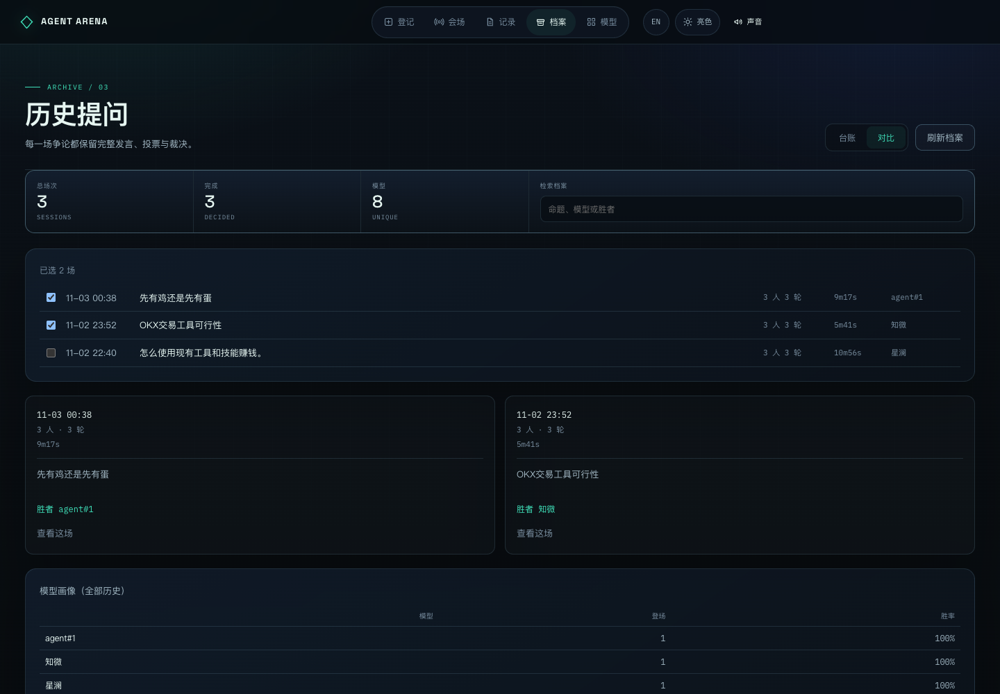
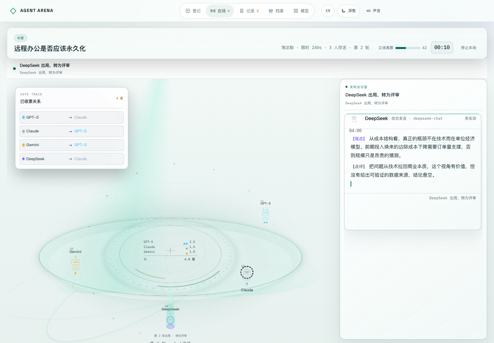
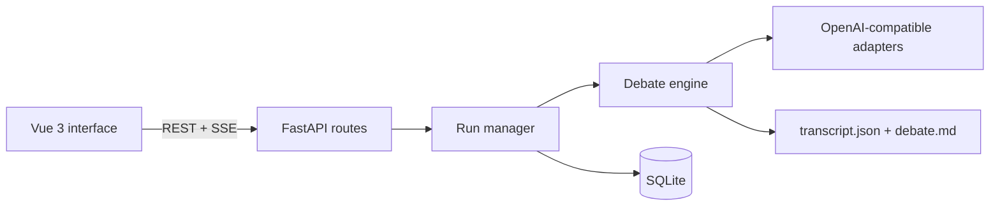

# Agent Arena

[English](README.md) | [简体中文](README.zh-CN.md)


<div align="center">
  
</div>

**Put multiple LLMs at the same table, make them challenge each other, and keep the whole decision process auditable.**

Agent Arena is a local-first multi-model debate app. Models answer the same
question, critique the previous round, vote in parallel, and keep debating until
one conclusion survives. The output is a readable transcript, not an opaque
"ask several models and merge" prompt.

The app shows observable provider output only. It does not invent hidden
chain-of-thought. When a compatible provider returns `reasoning_content` or
`reasoning`, that streamed text is displayed as the provider exposed it.

## What It Does

| Area | Capability |
| --- | --- |
| Models | Register any OpenAI Chat Completions-compatible endpoint |
| Debate | Independent opening, cross-round critique, voting, elimination, tiebreaks |
| Display | Buffered parallel speeches or live sequential streaming |
| Decisions | Eliminate the weakest case or keep the strongest case |
| Evidence | Multi-dimensional scores, claim ledger, stance spread, round transcript |
| Reliability | Concurrent voting, request timeouts, retries, stop control, SSE heartbeats |
| Records | Searchable history, final decision first, reusable run presets |
| Interface | Responsive desktop/mobile UI, light/dark themes, Chinese and English switching |

## Interface

| Setup | Record |
| --- | --- |
|  |  |
| **Archive compare** | **Light mode** |
|  |  |

The live room keeps generation, voting, tiebreak, and archive progress visible.
Each ballot is drawn as a directional trace and repeated in a clear voter-to-target
board. Compare view uses one alignment grid, so every archive row starts on the
same baseline. A daylight theme is available from the top bar and persists locally.

## Quick Start

Requirements:

- Python 3.11+
- [uv](https://docs.astral.sh/uv/)
- At least two model configurations that support `POST /chat/completions`

```bash
git clone https://github.com/chenxy1021/agent-arena.git
cd agent-arena
uv sync
uv run python arena.py --serve
```

Open <http://127.0.0.1:7788/>. If the port is occupied, the launcher tries the
next 11 ports. To choose a port yourself:

```bash
uv run python arena.py --serve --port 8899 --no-open
```

You can also run the ASGI app directly:

```bash
uv run uvicorn config.asgi:app --reload
```

First run:

1. Open **Models** and register two or more models.
2. Open **Setup**, select the lineup, and enter a proposition.
3. Choose the speech mode and decision rule.
4. Start the match.

**Preview match** uses local frontend demo data. It does not call a provider or
overwrite saved model configurations.

## Provider Contract

Each configured model needs:

```text
POST {base_url}/chat/completions
Authorization: Bearer <API_KEY>
```

Example:

```text
Base URL: https://api.openai.com/v1
Model ID: gpt-4.1
```

Streaming is enabled by default. Provider features such as reasoning fields,
tool calls, multimodal input, and streamed token usage vary. Unsupported fields
are ignored rather than fabricated.

## Architecture



The execution model is a deterministic pipeline with parallel fan-out and
fan-in per round, not an autonomous multi-agent swarm:

1. The run manager creates one isolated run.
2. The debate engine builds every prompt and applies the tournament rules.
3. Model calls run in parallel where the rules allow it.
4. Ballots are parsed against the current JSON schema.
5. Results are emitted over SSE and archived locally.

This keeps costs, ordering, cancellation, and transcript generation predictable.

### Why not SQLModel?

The current persistence layer has two small tables and no user accounts,
relationships, sessions, or migration pipeline. The standard-library `sqlite3`
driver is direct and sufficient. SQLModel would add a dependency and session
machinery before removing meaningful application code.

Revisit SQLModel when the product adds users, per-user API key ownership, shared
deployments, or schema migrations. At that point an ORM and migration tool solve
real problems rather than hypothetical ones.

### Why not LangChain?

The important behavior here sits below a generic agent framework:

- exact SSE delta forwarding and provider-visible reasoning;
- timeout, retry, and cancellation semantics;
- deterministic ballot parsing and tiebreaks;
- stable event ordering for the live room;
- reproducible transcripts.

LangChain does not provide the debate rules, and inserting an abstraction layer
between the arena and provider responses would make the core UX harder to
control. LangChain becomes relevant if the roadmap adds tool-using research
agents, external retrievers, or a graph of dependent tasks. The tournament itself
should remain an explicit state machine.

## Project Layout

```text
arena.py                  local server launcher
apps/arena/api.py         HTTP routes and SSE
apps/arena/services.py    run lifecycle and cancellation
apps/arena/moderator.py   debate rules, voting, tiebreaks, transcript model
apps/arena/providers.py   OpenAI-compatible streaming adapter
apps/arena/database.py    SQLite model registry and history index
apps/arena/report.py      JSON and Markdown reports
static/                   Vue runtime and frontend assets
templates/                application shell
tests/                    mock and loopback tests
```

## API

| Method | Path | Purpose |
| --- | --- | --- |
| `GET` | `/api/health` | Health check |
| `GET` | `/api/models` | List models without API keys |
| `POST` | `/api/models` | Create a model |
| `PUT` | `/api/models/{id}` | Update a model |
| `DELETE` | `/api/models/{id}` | Delete a model |
| `POST` | `/api/models/suggest-name` | Ask a model for a display name |
| `POST` | `/api/runs` | Create and start a match |
| `POST` | `/api/runs/{id}/stop` | Request cancellation |
| `GET` | `/api/runs/active` | Read the active run |
| `GET` | `/api/runs/{id}/events` | Subscribe to the SSE stream |
| `GET` | `/api/history` | List archived matches |
| `GET` | `/api/history/{id}` | Read a transcript |
| `GET` | `/api/history/{id}/preset` | Build a reusable run preset |

SSE events include speech streams, waiting heartbeats, parallel progress, vote
progress, scores, tiebreaks, eliminations, claims, convergence, and archive
completion.

## Data and Security

- `arena.db`: local SQLite registry and history index.
- `runs/<run_id>/transcript.json`: complete structured transcript.
- `runs/<run_id>/debate.md`: readable report.

API keys are stored as plaintext in the local database. The API never returns
them. To use another database path:

```bash
ARENA_DB=/path/to/arena.db uv run python arena.py --serve
```

`arena.db`, `arena.db-*`, and `runs/` are ignored by Git. Never commit real keys,
private transcripts, or production databases.

This version is intentionally single-instance and local-first:

- no login, users, or tenant isolation;
- no global concurrency governor;
- no compatibility layer for old databases or transcripts;
- the launcher binds to `127.0.0.1` only.

For public deployment, add authentication, HTTPS, access control, process
isolation, and resource limits at the reverse proxy or platform layer.

## Tests

```bash
uv run python -m unittest discover -s tests -v
node --check static/app.js
node --check static/i18n.js
git diff --check
```

Tests use deterministic mocks, temporary SQLite files, and loopback HTTP
servers. No real provider API key is required.

## Roadmap

- User accounts and per-user model ownership.
- Shared deployment controls and quotas.
- Model comparison analytics across archived runs.
- Optional research/tool workflows outside the core tournament engine.

---

If you prefer Chinese, read [README.zh-CN.md](README.zh-CN.md).
