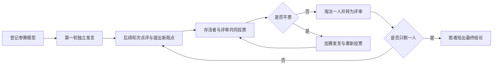

# Agent Arena

**让多个大模型坐上一张真正的辩论桌。**

Agent Arena 是一个面向大模型的多智能体辩论与决策实验平台。它让不同厂商、不同型号的模型围绕同一个问题独立发表观点，在后续轮次中互相点评、质疑和回应，再通过公开投票逐轮淘汰，最终留下一个经过对抗检验的答案。


---

## 它解决什么问题

单个模型给出的答案往往看起来完整，却可能建立在未经检验的前提上。换一个模型、换一个提示词，结论可能完全不同。

Agent Arena 不把多个角色塞进一次 Prompt，也不模拟一场“看起来像辩论”的对话。每个参赛模型都有独立的 API 配置、独立上下文和独立投票权。它们会看到彼此的前几轮发言，但不能偷看同一轮尚未公开的输出；它们必须指出此前谁回答得最好、谁回答得最差，并在投票时为自己的判断负责。

这使它适合用于：

- 对重要方案、判断和决策做压力测试
- 比较不同模型在同一问题上的真实表现
- 从分歧中发现被忽略的风险、证据和假设
- 生成带完整推理轨迹的讨论记录与决策档案
- 研究多模型协作、竞争和评审机制

> Agent Arena 展示的是服务商实际返回的可观察输出，不伪造模型隐藏的思维链。

## 核心特性

### 真正的多模型参赛

通过 OpenAI-compatible `/chat/completions` 接口接入任意模型。不同模型可以来自不同服务商，也可以使用不同的系统提示词、温度和模型 ID。

### 有约束的辩论赛制

- 第一轮独立发言，不点评、不投票，也看不到其他模型本轮输出
- 第二轮起，先选出此前回答最好和最差的模型并说明原因，再提出自己的新观点
- 本轮其他模型尚未公开的发言不会进入当前模型上下文
- 第二轮结束后开始投票，此后每轮淘汰一人

### 淘汰者转为评审

被淘汰的模型不再发言，但仍保留投票权。观点可以离场，判断不会立刻失效。

### 完整处理平票

平票不会随机淘汰参赛者。平票模型先进行加赛发言，再由原投票者重新投票；如果仍然平票，则逐次移出投票人继续表决。所有加赛阶段、投票和票数都和普通投票分开记录。

### 实时、可观察的比赛过程

页面通过 SSE 接收比赛事件：

- 每位模型当前的发言阶段与流式输出
- 每位投票者正在判断、投给谁以及投票理由
- 普通投票与每一次加赛投票的独立计票
- 淘汰、技术退赛、胜者和最终结论

### 本地优先

模型配置、API Key 和比赛索引保存在本机 SQLite；完整战报保存在本地 `runs/` 目录。服务默认只监听 `127.0.0.1`，不依赖云端数据库或账号系统。

### 可回放的历史档案

每场比赛都会生成结构化 JSON 与可读 Markdown 战报。网页中可以查看历史提问，回放各轮发言、投票、平票加赛和最终结果。

### 不引入前端构建链

前端使用 Vue 3 本地运行时，后端直接提供模板和静态资源。克隆项目后即可运行，不需要 Node.js 构建步骤。

## 比赛流程



## 快速开始

### 环境要求

- Python 3.11+
- [uv](https://docs.astral.sh/uv/)
- 至少两个兼容 OpenAI Chat Completions 的模型配置

### 安装与启动

```bash
git clone https://github.com/chenxy1021/agent-arena.git
cd agent-arena

uv sync
uv run python arena.py --serve
```

服务默认打开：

```text
http://127.0.0.1:7788/
```

如果端口已被占用，程序会自动向后寻找可用端口。

也可以直接启动 ASGI 应用：

```bash
uv run uvicorn config.asgi:app --reload
```

## 添加模型

在页面「参赛登记」区域点击「＋ 登记模型」，填写：

| 字段 | 说明 |
| --- | --- |
| 显示名称 | 比赛中展示的名字 |
| Base URL | 例如 `https://api.openai.com/v1` |
| API Key | 仅保存在本机 |
| 模型 ID | 服务商提供的模型标识 |
| 系统提示词 | 可选 |
| 温度 | 可选 |

接口需要兼容：

```text
POST /chat/completions
```

Agent Arena 支持流式响应，也能读取部分服务商返回的 `reasoning_content` 或 `reasoning` 字段。

登记界面提供「自动取名」按钮。它会真实调用当前模型配置，用返回结果生成显示名称，同时验证 Base URL、API Key 和模型 ID 是否可用。

## 投票规则

Agent Arena 提供两种比赛模式：

- **淘汰制**：投给观点最站不住、论证最薄弱的一位，票多者出局
- **评选制**：投给观点最正确、论证最扎实的一位，票少者出局

投票由模型阅读本轮全部发言后独立完成。计票本身只是本地统计，不会额外调用模型。

### 平票处理

1. 平票模型进行加赛发言，只补充新论据或回应争议
2. 原投票者只针对平票模型重新投票
3. 如果仍然平票，随机移出一位投票人后继续投票
4. 投票人耗尽仍无有效票时，按本轮发言信息量裁决

每个加赛阶段都有独立的投票记录和计票结果，不会与普通投票混在一起。

## 数据与隐私

- API Key 以明文保存在本机 `arena.db`
- 模型列表接口不会返回 API Key
- 完整辩论记录保存在本地 `runs/`
- 默认服务只监听 `127.0.0.1`

不要把 `arena.db`、`runs/` 或包含真实密钥的配置文件提交到公开仓库。

## 技术栈

- **后端**：FastAPI、Uvicorn
- **前端**：Vue 3，无构建步骤
- **实时通信**：Server-Sent Events（SSE）
- **存储**：SQLite + 本地 JSON/Markdown 战报
- **依赖与运行**：uv

后端提供 REST API 与 SSE 事件流；前端独立处理比赛、轮次、发言、投票和加赛状态。

## 开发

运行测试：

```bash
uv run python -m unittest discover -s tests -v
node --check static/app.js
```

项目当前处于持续迭代阶段。赛制、事件格式和界面仍可能调整；欢迎提交 Issue、改进提示词、补充测试，或分享不同模型组合下的比赛记录。

## 贡献

提交代码前请确保：

- 新增逻辑有对应测试
- 不提交任何真实 API Key
- 保持 SSE 事件与前端状态兼容
- 不引入不必要的运行时依赖或前端构建步骤

如果这个项目对你有帮助，欢迎点一个 Star，或把你觉得有意思的模型对阵和辩论结果分享出来。
