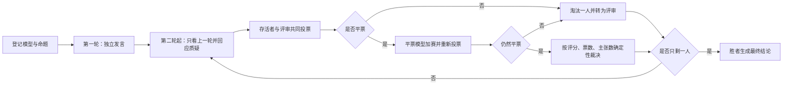

# Agent Arena

**让多个大模型坐上一张真正的辩论桌，把一次判断变成可复盘的决策过程。**

Agent Arena 是一个本地优先的多模型辩论与压力测试工具。不同厂商、不同型号的模型围绕同一个命题独立发言，随后只基于上一轮公开内容互相质疑、修正观点并投票淘汰，最后留下一个经过多轮对抗的结论。

它不是把多个角色塞进一次 Prompt 的角色扮演，也不是展示模型隐藏思维链的“推理秀”。页面只展示服务商实际返回的可观察输出、投票理由和本地统计数据。


## 它适合做什么

- 对重要方案、商业判断或技术选型做多模型压力测试
- 比较不同模型在同一个问题上的论证、证据和可执行性
- 追踪一个观点被谁提出、被谁挑战，最后是否进入结论
- 留下完整的发言、投票、评分和分歧档案，方便复盘
- 研究多模型竞争、评审和淘汰机制

## 当前功能

### 多模型登记

通过 OpenAI-compatible `POST /chat/completions` 接口接入模型。每个模型配置独立保存：

- 显示名称
- Base URL
- API Key
- 模型 ID
- 系统提示词
- 温度
- 可选人格预设：审计员、务实派、反方、红队、归纳者

一场比赛可以选择 2 到 16 个模型。人格只影响发言，不影响投票，避免角色设定污染评审判断。

### 结构化命题

登记页除了命题本身，还可以填写：

- 背景材料
- 约束条件
- 评判标准

这些内容会进入发言、投票和最终总结的 Prompt，让模型不必在真空中讨论。

### 两种发言方式

- **并行缓冲（默认）**：所有存活模型同时生成，本轮完成后按顺序同屏展示全员发言串，适合快速跑完一整场。
- **逐个实时**：模型依次发言，页面实时显示当前模型的流式输出，适合观察现场过程。

两种模式都不会让模型看到同一轮尚未公开的其他模型输出。

### 两种淘汰规则

- **淘汰制**：投给观点最站不住、论证最薄弱的一位，票多者出局。
- **评选制**：投给观点最正确、论证最扎实的一位，票少者出局。

第一轮只做独立发言，不投票。至少从第二轮结束后才开始淘汰。

### 评审席与加权票

被淘汰的模型不再发言，但会转为评审，继续参与后续投票：

- 存活者票权重为 `1.0`
- 评审票权重默认为 `0.5`
- 当存活者只剩 2 人时，评审票权重为 `0`，避免后排意见主导终局

每轮页面和战报都会显示票权来源，不会把评审票和存活票混在一起。

### 确定性的平票处理

出现平票时：

1. 平票模型先进行加赛发言，只补充新论据或回应争议。
2. 原投票者只针对平票模型重新投票。
3. 如果仍然平票，按以下顺序确定性裁决：
   - 多维评分更高者留下
   - 存活者票更多者留下
   - 本轮新增主张更多者留下
   - 最后按稳定、可复现的顺序裁决

整个过程不会随机移出投票人，也不会用随机数决定谁出局。

### 评分矩阵与主张台账

投票者会按四个维度给存活模型打 `0-10` 分：

- 论证
- 证据
- 可执行
- 增量

这些评分会聚合为每轮评分矩阵。模型发言中的原子主张会进入主张台账，记录提出者、轮次、挑战者、支持者和最终状态。

### 立场与收敛读数

模型可以在发言中输出 `【立场】-100..100`。页面会计算存活模型的立场离散度，并用它展示当前是趋于收敛还是分歧较大。

- 首轮不判断收敛
- 至少第二轮后才可能出现“收敛”读数
- 收敛只是赛况读数，不会跳过后续投票或提前结束比赛
- 分歧过大时会自动追加轮次
- 立场是模型自报的启发式数据，不等于事实上的共识

### 完整战报与再赛

每场比赛会生成：

- `transcript.json`：完整结构化数据，当前 `schema_version = 3`
- `debate.md`：可读的 Markdown 战报

新战报会保存完整 `setup` 快照，包括命题、规则、发言方式、超时、背景、约束、评判标准和模型配置 ID。

“再赛”只会把当前格式的比赛预设回填到登记页，不会自动开赛，也不会立即调用模型。模型配置缺失时会要求人工重新选择。

### 本地预览

登记页的“预览一场”使用纯前端假数据，不发任何模型请求，也不会覆盖真实模型登记。适合在没有 API Key 时检查布局和动效。

## 界面

主界面包含五个页面：

- **登记**：填写命题、背景、约束、评判标准，选择模型、规则和发言方式。
- **会场**：查看圆桌席位、并行发言看板、实时流、投票、加赛、淘汰和赛况 HUD。
- **记录**：最终结论置顶展示，下面按轮回放发言、投票、评分矩阵、主张台账和分歧。
- **档案**：查看历史比赛、比较场次、查看模型画像，并从完整预设发起再赛。
- **模型**：管理本机模型配置和人格预设。

## 比赛流程



最终结论要求包含：

- 明确结论
- 三条以内论据
- 至少一条保留的分歧
- 结论的失效条件

## 快速开始

### 环境要求

- Python 3.11+
- [uv](https://docs.astral.sh/uv/)
- 至少两个兼容 OpenAI Chat Completions 的模型配置

不需要 Node.js 构建前端。仓库内已经包含 Vue 3 本地运行时。

### 安装与启动

```bash
git clone https://github.com/chenxy1021/agent-arena.git
cd agent-arena

uv sync
uv run python arena.py --serve
```

默认地址：

```text
http://127.0.0.1:7788/
```

通过 `arena.py --serve` 启动时，如果 `7788` 被占用，会在后续端口中自动寻找可用端口。

也可以直接启动 ASGI 应用：

```bash
uv run uvicorn config.asgi:app --reload
```

### 第一次使用

1. 打开「模型」，登记至少两个 OpenAI-compatible 模型。
2. 打开「登记」，选择参赛模型。
3. 填写命题；需要时展开背景、约束和评判标准。
4. 选择淘汰制或评选制，以及并行缓冲或逐个实时。
5. 点击开始比赛。

「自动取名」会真实调用当前填写的模型配置；「预览一场」不会调用模型。

### 离线试用

没有 API Key 时，可以先使用前端预览检查界面。命令行也保留了本地 Mock 流程：

```bash
uv run python arena.py "该不该把核心服务迁移到新架构" --mock 4
```

Mock 模式只使用本地假 Agent，不访问外部模型。

## 模型接口

模型服务需要兼容：

```text
POST {base_url}/chat/completions
Authorization: Bearer <API_KEY>
```

例如：

```text
Base URL: https://api.openai.com/v1
模型 ID: gpt-4.1
```

服务支持流式响应，并会读取部分兼容服务返回的 `reasoning_content` 或 `reasoning` 字段。不同服务商对工具调用、多模态、推理字段和流式 usage 的支持程度不同，本项目只依赖标准 Chat Completions 文本响应。

## API 与 SSE

服务默认提供以下接口：

| 方法 | 路径 | 用途 |
| --- | --- | --- |
| `GET` | `/api/health` | 健康检查 |
| `GET` | `/api/models` | 列出模型配置，不返回 API Key |
| `POST` | `/api/models` | 新建模型配置 |
| `PUT` | `/api/models/{id}` | 更新模型配置 |
| `DELETE` | `/api/models/{id}` | 删除模型配置 |
| `POST` | `/api/models/suggest-name` | 调用模型生成显示名称 |
| `POST` | `/api/runs` | 创建并启动比赛 |
| `POST` | `/api/runs/{id}/stop` | 请求中止比赛 |
| `GET` | `/api/runs/active` | 查询当前活动比赛 |
| `GET` | `/api/runs/{id}/events` | 订阅比赛 SSE 事件流 |
| `GET` | `/api/history` | 列出历史比赛 |
| `GET` | `/api/history/{id}` | 读取单场完整战报 |
| `GET` | `/api/history/{id}/preset` | 将历史预设解析为登记草稿 |

`POST /api/runs` 和 `POST /api/models/suggest-name` 会真实请求模型服务。只查看页面、历史或使用“预览一场”不会触发模型调用。

SSE 事件通过 `id` 递增，支持 `?after=N` 和 `Last-Event-ID` 重连偏移；前端会过滤重复发言。事件包含轮次、模型输出、投票进度、计票、评分、加赛、淘汰、主张、收敛读数和最终归档状态。

启动一场比赛的最小请求示例：

```json
{
  "proposition": "远程办公应该永久化吗？",
  "model_ids": [1, 2, 3],
  "vote_mode": "eliminate",
  "speech_mode": "parallel_buffered",
  "timeout": 240,
  "background": "团队分布在北京和上海。",
  "constraints": ["不能增加固定办公成本"],
  "criteria": ["论据是否可验证", "方案是否能落地"]
}
```

## 数据与存储

- `arena.db`：SQLite，保存模型配置和历史索引
- `runs/<run_id>/transcript.json`：完整结构化战报
- `runs/<run_id>/debate.md`：面向阅读的 Markdown 战报

API Key 会以明文保存在本机 SQLite 中；模型列表接口不会返回 Key。可以通过 `ARENA_DB` 环境变量指定数据库文件：

```bash
ARENA_DB=/path/to/arena.db uv run python arena.py --serve
```

`arena.db`、`arena.db-*` 和 `runs/` 已经在 `.gitignore` 中。不要把它们或任何真实 API Key 提交到公开仓库。

模型请求会直接发送到你配置的服务商，不经过 Agent Arena 的云端中转。命题、背景和约束会随请求发送给参赛模型。

## 部署边界

当前版本是**本地优先的单实例应用**：

- 没有登录、用户系统或多租户隔离
- 没有每个用户自己的模型库
- 没有面向多用户的全局并发治理
- 模型配置和比赛档案属于运行该实例的本机
- 默认启动器只监听 `127.0.0.1`

如果要公开部署，必须自行增加反向代理认证、访问控制、HTTPS、进程隔离和资源限制。不要把无认证的实例直接暴露到公网。

## 当前限制

- 不再提供调用次数、总时长或费用的硬预算上限；页面会显示运行用量，但用量不是停止条件。
- 不读取、迁移或兼容旧版数据库和旧版 `runs/` 战报。
- 模型兼容性取决于服务商是否正确实现 OpenAI Chat Completions。
- 评分、立场和收敛读数是模型输出与本地聚合的结果，不是客观事实。

## Roadmap

后续版本可以考虑：

- 登录、用户隔离和个人模型库
- 多用户部署时的并发与资源治理
- 更完整的跨场模型画像和导出
- 更多模型服务商适配与评测维度

这些能力不属于当前版本，当前实现不会假装已经具备。

## 技术栈

- **后端**：FastAPI、Uvicorn
- **前端**：Vue 3，无构建步骤
- **实时通信**：Server-Sent Events（SSE）
- **存储**：SQLite + 本地 JSON/Markdown 战报
- **依赖与运行**：uv

## 本地开发与测试

运行单元测试和静态检查：

```bash
uv run python -m unittest discover -s tests -v
node --check static/app.js
git diff --check
```

测试使用本地 Mock、临时 SQLite 和本地回环 HTTP 服务，不需要真实模型 API Key。手动点击「自动取名」或启动真实比赛时才会请求外部模型。

提交代码前请确保：

- 新增赛制逻辑有对应测试
- 不提交任何真实 API Key、`arena.db` 或 `runs/`
- 保持 SSE 事件和前端状态兼容
- 不引入不必要的运行时依赖或前端构建步骤

## 贡献

欢迎提交 Issue、改进 Prompt、补充测试，或分享不同模型组合下的辩论档案。

如果这个项目对你有帮助，欢迎点一个 Star。
