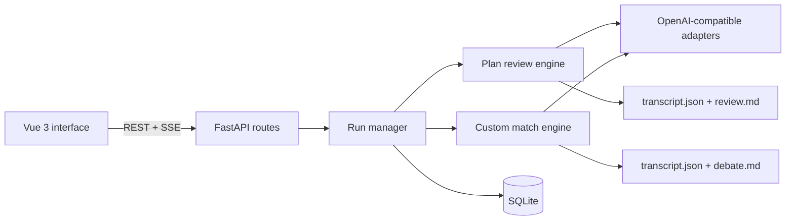

# Agent Arena

[English](README.md) | [简体中文](README.zh-CN.md)


<div align="center">
  
</div>

**Put multiple LLMs at the same table: compare executable plans with an independent judge, or run a custom elimination match with your own win condition.**

Agent Arena is a local-first multi-model decision arena with two modes:

- **Plan review** is the default. Models answer independently, an independent
  judge scores anonymized and shuffled plans, and the result includes a ranking,
  a recommendation, rejection reasons, and an integrated action plan.
- **Custom mode** makes models challenge one another across elimination rounds.
  You define the win condition; it is sent to every speech, vote and final
  synthesis prompt while the match still advances by elimination.

The output is an auditable transcript, not an opaque "ask several models and
merge" prompt. The interface only displays provider-visible output. It does not
invent hidden chain-of-thought; when a compatible provider returns
`reasoning_content` or `reasoning`, that streamed text is shown as exposed.

## What It Does

| Area | Capability |
| --- | --- |
| Models | Register any OpenAI Chat Completions-compatible endpoint |
| Plan review | Parallel independent answers, anonymous shuffled judging, four-dimension scores, recommendation and synthesis |
| Custom mode | Required win condition, cross-round debate, parallel voting, elimination, tiebreaks and final summary |
| Decisions | Default to the most executable plan, or decide a custom match by its stated win condition |
| Evidence | Score matrix, rejection reasons, claim ledger, stance spread and complete round transcript |
| Reliability | Timeouts, retries, stop control, SSE progress heartbeats and explicit failure diagnostics |
| Records | Mode-aware history, searchable archive, reusable presets and no cross-mode mixed ranking |
| Interface | Responsive desktop/mobile UI, daylight/dark themes, Chinese and English switching |

## Two Modes

| | Plan Review | Custom Mode |
| --- | --- | --- |
| Best for | Fast comparison of executable plans | Stress-testing a contested position with a specific win rule |
| Participants | 2-8 models | 2-8 models |
| Judge | One independent model outside the lineup | Participants vote on one another |
| Win condition | Not applicable | Required; defaults to `Vote until one remains` |
| Typical cost | `N + 2` calls | Multi-round, usually slower |
| Output | Comparison matrix, recommendation, rejection reasons, synthesis | Winner or undecided result with the full debate trail |
| Default | Yes | Optional deep-dive mode |

Review judging is anonymous and deterministic-order shuffled. The judge sees
`方案1...方案N`, not model names. Every non-recommended plan receives a concrete
rejection reason, and the final synthesis must state its assumptions and failure
conditions.

## Interface

| Setup | Review record |
| --- | --- |
|  |  |
| **Archive compare** | **Light mode** |
|  |  |

The live review chamber shows each plan as it arrives, the judging phases, the
four-dimension comparison, recommendation, rejection reasons and integration
steps. The custom match room keeps generation, voting, tiebreak and archive progress
visible. The daylight theme and language selection persist locally.

## Quick Start

Requirements:

- Python 3.11+
- [uv](https://docs.astral.sh/uv/)
- For review mode, at least three model configurations: two participants and one
  independent judge
- For custom mode, at least two model configurations

```bash
git clone https://github.com/chenxy1021/agent-arena.git
cd agent-arena
uv sync
uv run python arena.py --serve
```

Open <http://127.0.0.1:7788/>. If the port is occupied, the launcher tries the
next 11 ports. To choose a port yourself:

```bash
uv run python arena.py --serve --port 8899 --no-open
```

You can also run the ASGI app directly:

```bash
uv run uvicorn config.asgi:app --reload
```

First run:

1. Open **Models** and register the endpoints you want to use.
2. Open **Setup** and choose **Plan Review** or **Custom Mode**.
3. Select 2-8 participants. For plan review, also select a judge that is not in
   the participant list.
4. For custom mode, enter a required win condition (for example, `Vote until one
   remains`, or a camp-based rule). Enter the proposition, background,
   constraints and evaluation notes.
5. Start the run.

**Preview match** uses local frontend mock data. It does not call a provider,
create a backend run, or overwrite saved model configurations.

## Provider Contract

Each configured model needs:

```text
POST {base_url}/chat/completions
Authorization: Bearer <API_KEY>
```

Example:

```text
Base URL: https://api.openai.com/v1
Model ID: gpt-4.1
```

Streaming is enabled by default. Provider features such as reasoning fields,
tool calls, multimodal input and streamed token usage vary. Unsupported fields
are ignored rather than fabricated.

## Architecture



The execution model is a deterministic pipeline with parallel fan-out and
fan-in, not an autonomous multi-agent swarm:

1. The run manager creates one isolated run and validates the mode, lineup and
   judge independence.
2. Plan review fans out independent answers, anonymizes and shuffles valid
   plans, then asks the judge for structured scoring and synthesis.
3. Custom mode injects the user's win condition into every prompt and applies
   the elimination state machine, voting weights and tiebreak rules.
4. Results are emitted over SSE and archived locally.

This keeps costs, ordering, cancellation and transcript generation predictable.

### Why not SQLModel?

The current persistence layer has two small tables and no user accounts,
relationships, sessions or migration pipeline. The standard-library `sqlite3`
driver is direct and sufficient. SQLModel would add a dependency and session
machinery before removing meaningful application code.

Revisit SQLModel when the product adds users, per-user API key ownership, shared
deployments or schema migrations. At that point an ORM and migration tool solve
real problems rather than hypothetical ones.

### Why not LangChain?

The important behavior here sits below a generic agent framework:

- exact SSE delta forwarding and provider-visible reasoning;
- timeout, retry and cancellation semantics;
- deterministic structured judging and ballot parsing;
- stable event ordering for the live room;
- reproducible transcripts and mode-specific comparability.

LangChain does not provide the review rubric or debate rules, and inserting an
abstraction layer between the arena and provider responses would make the core
UX harder to control. LangChain becomes relevant if the roadmap adds tool-using
research agents, external retrievers or a graph of dependent tasks. The arena
itself should remain an explicit state machine.

## Project Layout

```text
arena.py                  local server launcher
apps/arena/api.py         HTTP routes and SSE
apps/arena/services.py    run lifecycle, mode dispatch and cancellation
apps/arena/review.py      plan review, anonymous judging and synthesis
apps/arena/moderator.py   debate rules, voting, tiebreaks and transcript model
apps/arena/providers.py   OpenAI-compatible streaming adapter
apps/arena/database.py    SQLite model registry and history index
apps/arena/report.py      JSON and Markdown reports
static/                   Vue runtime and frontend assets
templates/                application shell
tests/                    mock and loopback tests
```

## API

| Method | Path | Purpose |
| --- | --- | --- |
| `GET` | `/api/health` | Health check |
| `GET` | `/api/models` | List models without API keys |
| `POST` | `/api/models` | Create a model |
| `PUT` | `/api/models/{id}` | Update a model |
| `DELETE` | `/api/models/{id}` | Delete a model |
| `POST` | `/api/models/suggest-name` | Ask a model for a display name |
| `POST` | `/api/runs` | Create and start a review or custom elimination run; `win_condition` is required |
| `POST` | `/api/runs/{id}/stop` | Request cancellation |
| `GET` | `/api/runs/active` | Read the active run |
| `GET` | `/api/runs/{id}/events` | Subscribe to the SSE stream |
| `GET` | `/api/history` | List archived runs with mode metadata |
| `GET` | `/api/history/{id}` | Read a transcript |
| `GET` | `/api/history/{id}/preset` | Build a reusable run preset |

Review SSE events include independent answer progress, anonymized labels,
judge retries, score results, recommendation and synthesis. Custom mode SSE events
include speech streams, waiting heartbeats, parallel progress, vote progress,
scores, tiebreaks, eliminations, claims, convergence and archive completion.

## Data and Security

- `arena.db`: local SQLite registry and history index.
- `runs/<run_id>/transcript.json`: complete structured transcript.
- `runs/<run_id>/review.md` or `debate.md`: readable report.

API keys are stored as plaintext in the local database. The API never returns
them. To use another database path:

```bash
ARENA_DB=/path/to/arena.db uv run python arena.py --serve
```

`arena.db`, `arena.db-*` and `runs/` are ignored by Git. Never commit real keys,
private transcripts or production databases.

This version is intentionally single-instance and local-first:

- no login, users or tenant isolation;
- no global concurrency governor;
- no compatibility layer for legacy databases or transcripts;
- the launcher binds to `127.0.0.1` only.

For public deployment, add authentication, HTTPS, access control, process
isolation and resource limits at the reverse proxy or platform layer.

## Tests

```bash
uv run python -m unittest discover -s tests -v
node --check static/app.js
node --check static/i18n.js
git diff --check
```

Tests use deterministic mocks, temporary SQLite files and loopback HTTP servers.
No real provider API key is required.

## Roadmap

- User accounts and per-user model ownership.
- Shared deployment controls and quotas.
- Multi-judge review panels and human adoption decisions.
- Optional research/tool workflows outside the core review and custom match engines.
