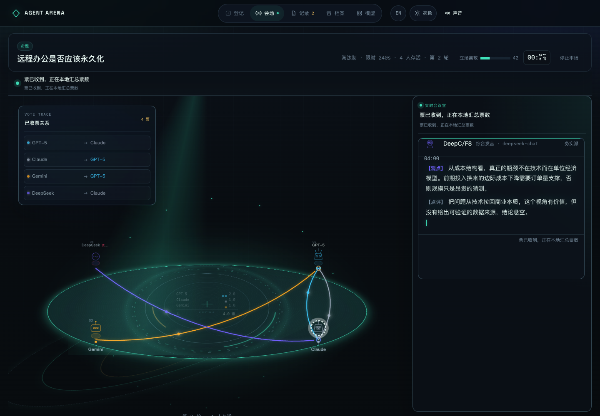
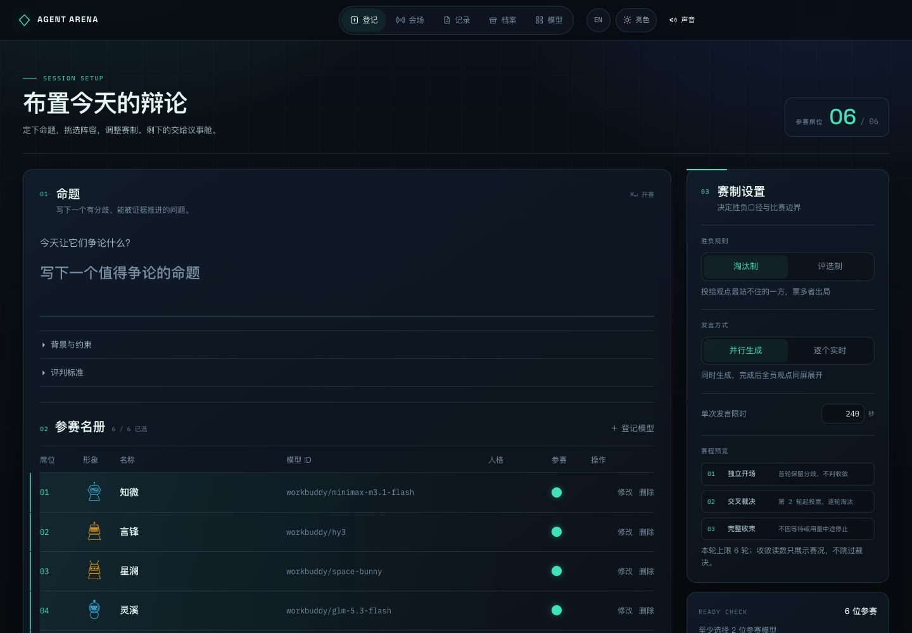
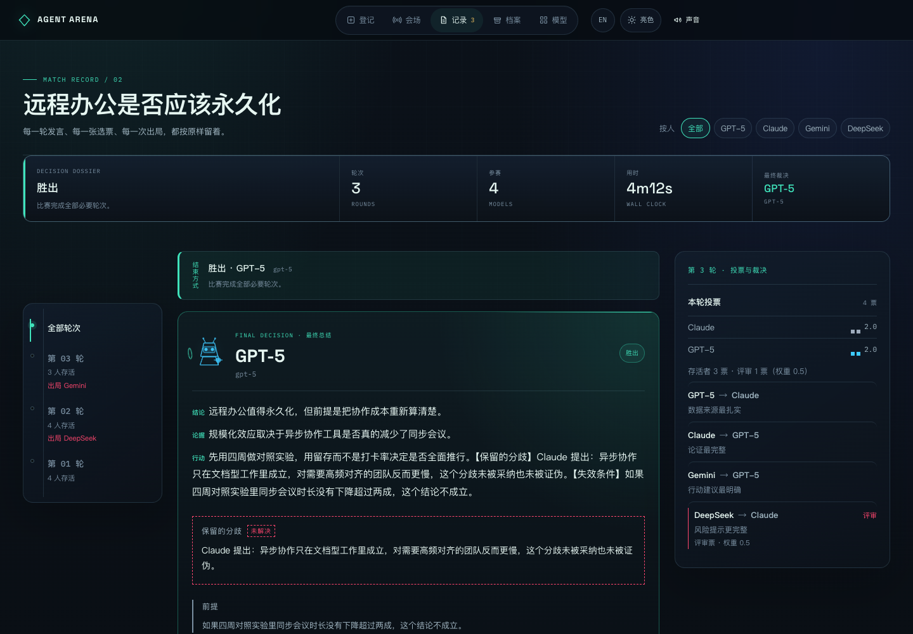
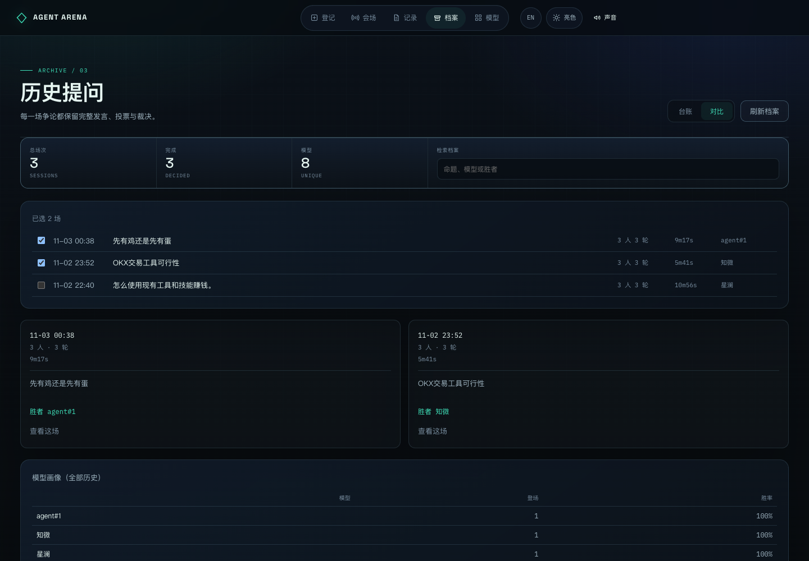
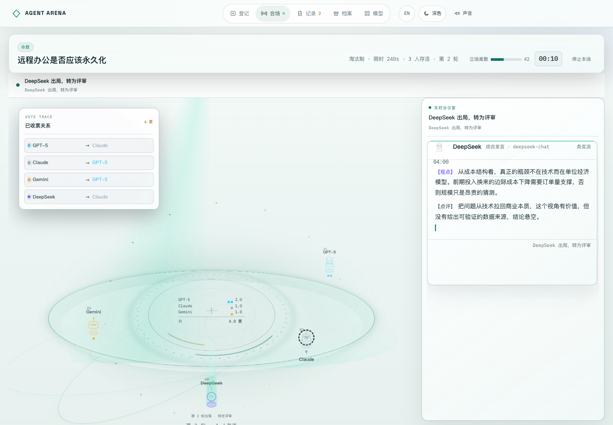
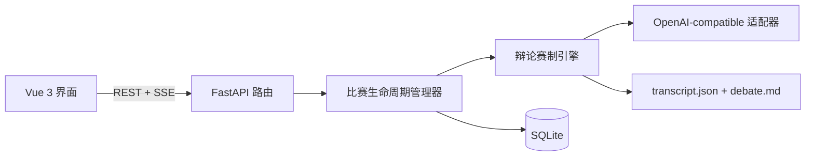

# Agent Arena

[English](README.md) | [简体中文](README.zh-CN.md)


<div align="center">
  
</div>

**让多个大模型坐上一张真正的辩论桌，互相质疑、投票、淘汰，最后留下一个可复盘的结论。**

Agent Arena 是一个本地优先的多模型辩论应用。不同模型围绕同一个命题独立发言，
下一轮基于上一轮公开内容互相点评，并通过并发投票和淘汰推进讨论。它输出的是完整
战报，而不是把多个模型的答案揉进一个不可追踪的 Prompt。

页面只展示服务商实际返回的可观察输出，不伪造隐藏思维链。如果兼容服务返回
`reasoning_content` 或 `reasoning`，页面会按服务商实际流式返回的内容展示。

## 核心能力

| 模块 | 能力 |
| --- | --- |
| 模型 | 登记任意兼容 OpenAI Chat Completions 的接口 |
| 赛制 | 独立开场、跨轮点评、投票、淘汰、加赛、最终总结 |
| 发言 | 并行生成后同屏公开，或逐个实时流式输出 |
| 裁决 | 淘汰最弱观点，或评选最该留下的观点 |
| 证据 | 多维评分、主张台账、立场离散度、完整轮次记录 |
| 稳定性 | 并发投票、超时重试、中止控制、SSE 心跳 |
| 记录 | 历史检索、最终结论置顶、复用历史预设再赛 |
| 界面 | 桌面与移动端自适应，支持亮色/深色主题，中英文随时切换 |

## 界面

| 登记页 | 记录页 |
| --- | --- |
|  |  |
| **档案对比** | **亮色模式** |
|  |  |

会场会持续展示生成、投票、加赛和归档状态。每张选票会画出方向轨迹，并在
`投票人 → 目标` 流向板中重复展示；档案对比使用统一对齐网格；右上角可切换
亮色/深色主题，选择会保存在本地。

## 快速开始

环境要求：

- Python 3.11+
- [uv](https://docs.astral.sh/uv/)
- 至少两个支持 `POST /chat/completions` 的模型配置

```bash
git clone https://github.com/chenxy1021/agent-arena.git
cd agent-arena
uv sync
uv run python arena.py --serve
```

打开 <http://127.0.0.1:7788/>。如果端口被占用，启动器会继续尝试后续 11 个端口。
也可以自行指定：

```bash
uv run python arena.py --serve --port 8899 --no-open
```

或者直接启动 ASGI 应用：

```bash
uv run uvicorn config.asgi:app --reload
```

第一次使用：

1. 打开「模型」，登记至少两个模型。
2. 打开「登记」，选择参赛阵容并填写命题。
3. 选择发言方式和胜负规则。
4. 开始比赛。

「预览一场」只使用前端本地假数据，不请求模型接口，也不会覆盖已保存的模型配置。

## 模型接口

每个模型配置需要兼容：

```text
POST {base_url}/chat/completions
Authorization: Bearer <API_KEY>
```

示例：

```text
Base URL: https://api.openai.com/v1
模型 ID: gpt-4.1
```

应用默认启用流式响应。不同服务商对推理字段、工具调用、多模态输入和流式 usage
的支持程度不同；不支持的字段会被忽略，不会伪造。

## 架构



当前执行模型是确定性的流水线，每轮内部做并行 fan-out / fan-in，不是自主多
Agent 蜂群：

1. 生命周期管理器创建独立比赛。
2. 赛制引擎构造全部 Prompt 并应用辩论规则。
3. 规则允许时并行调用模型。
4. 使用当前 JSON ballot schema 解析投票。
5. 通过 SSE 推送过程，并在本地归档结果。

这样成本、顺序、中止和战报生成都可预测。

### 为什么不用 SQLModel？

当前只有两张小表，没有用户、关联关系、会话状态或迁移流程。标准库 `sqlite3`
足够直接，SQLModel 会增加依赖和 session 生命周期，却暂时减不掉多少应用代码。

等产品加入用户系统、每用户 API Key、共享部署或 schema 迁移后，再引入 ORM
和迁移工具才有实际收益。

### 为什么不用 LangChain？

这个项目的关键行为在通用 Agent 框架之下：

- 精确转发 SSE delta 与服务商公开的 reasoning；
- 控制超时、重试和中止语义；
- 确定性解析选票、平票和加赛；
- 保证实时会场的事件顺序；
- 生成可复现战报。

LangChain 不提供辩论赛制；在会场与服务商响应之间增加抽象层，反而会让实时体验
更难控制。如果未来增加工具调用、外部检索或依赖图任务，可以为这些新能力单独
引入 LangChain；核心赛制仍应保持显式状态机。

## 项目结构

```text
arena.py                  本地服务启动器
apps/arena/api.py         HTTP 路由与 SSE
apps/arena/services.py    比赛生命周期与中止
apps/arena/moderator.py   赛制、投票、加赛与战报模型
apps/arena/providers.py   OpenAI-compatible 流式适配器
apps/arena/database.py    SQLite 模型登记与历史索引
apps/arena/report.py      JSON 与 Markdown 战报
static/                   Vue 运行时与前端资源
templates/                应用外壳
tests/                    Mock 与回环测试
```

## API

| 方法 | 路径 | 用途 |
| --- | --- | --- |
| `GET` | `/api/health` | 健康检查 |
| `GET` | `/api/models` | 列出模型，不返回 API Key |
| `POST` | `/api/models` | 新建模型 |
| `PUT` | `/api/models/{id}` | 更新模型 |
| `DELETE` | `/api/models/{id}` | 删除模型 |
| `POST` | `/api/models/suggest-name` | 调用模型生成显示名 |
| `POST` | `/api/runs` | 创建并启动比赛 |
| `POST` | `/api/runs/{id}/stop` | 请求中止比赛 |
| `GET` | `/api/runs/active` | 查询当前活动比赛 |
| `GET` | `/api/runs/{id}/events` | 订阅 SSE 事件流 |
| `GET` | `/api/history` | 列出历史比赛 |
| `GET` | `/api/history/{id}` | 读取完整战报 |
| `GET` | `/api/history/{id}/preset` | 构造可复用的比赛预设 |

SSE 事件包含发言流、等待心跳、并行进度、投票进度、评分、加赛、淘汰、主张、
收敛状态和归档完成。

## 数据与安全

- `arena.db`：本地 SQLite 模型登记与历史索引。
- `runs/<run_id>/transcript.json`：完整结构化战报。
- `runs/<run_id>/debate.md`：可读 Markdown 战报。

API Key 以明文保存在本地数据库，模型列表接口不会返回 Key。可以指定其他数据库
路径：

```bash
ARENA_DB=/path/to/arena.db uv run python arena.py --serve
```

`arena.db`、`arena.db-*` 和 `runs/` 已在 `.gitignore` 中。不要把真实 API Key、
私有战报或生产数据库提交到仓库。

当前版本按单实例、本地优先设计：

- 没有登录、用户系统或多租户隔离；
- 没有全局并发治理；
- 不兼容旧版数据库或旧版战报；
- 启动器只监听 `127.0.0.1`。

如果要公开部署，必须在反向代理或平台层增加认证、HTTPS、访问控制、进程隔离和
资源限制。

## 测试

```bash
uv run python -m unittest discover -s tests -v
node --check static/app.js
node --check static/i18n.js
git diff --check
```

测试使用确定性 Mock、临时 SQLite 和回环 HTTP 服务，不需要真实模型 API Key。

## 路线图

- 用户系统与每用户模型归属。
- 共享部署控制与额度限制。
- 跨历史比赛的模型对比分析。
- 在核心赛制之外增加可选的研究/工具调用能力。

---

英文说明见 [README.md](README.md)。
